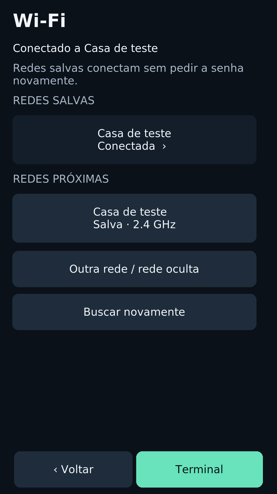
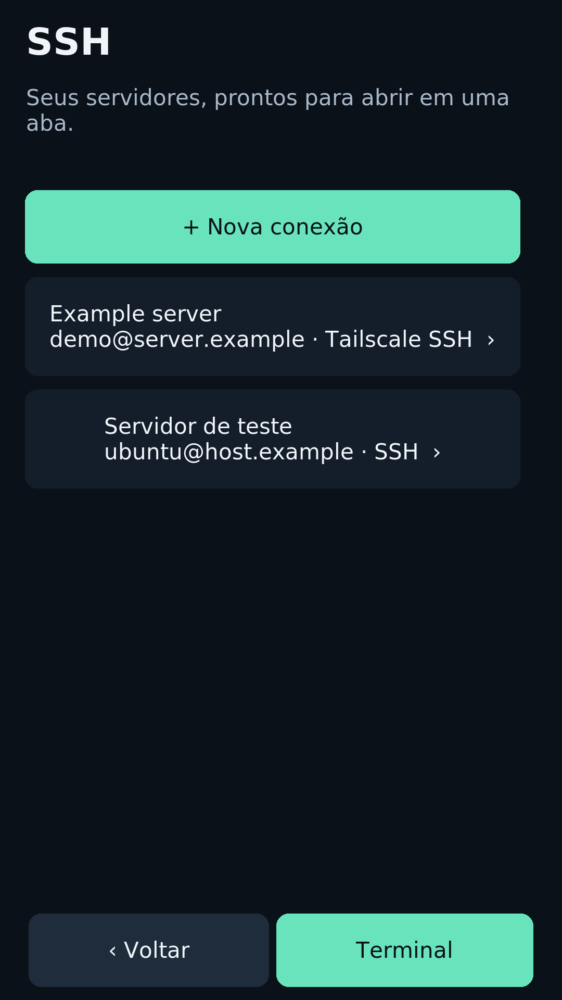

<p align="center">
  
</p>
<p align="center">
  <b>Your Hermes, with a face and a voice. Your Linux terminal, always there.</b><br>
  Turn a retired Moto G4 Plus into a voice companion and a pocket SSH terminal.
</p>
<p align="center">
  <a href="#bring-your-hermes-to-life">Meet Hermes</a> ·
  <a href="docs/hermes-setup.md#first-connection-checklist">Configure the app</a> ·
  <a href="docs/hermes-server-agent.md">Instructions for your Hermes server</a> ·
  <a href="docs/agent-installation.md">Install Linux</a> ·
  <a href="docs/status.md">Hardware status</a> ·
  <a href="docs/README.md">Documentation</a> ·
  <a href="https://github.com/holiveiraa/moto-g4-linux/wiki">Wiki</a> ·
  <a href="CREDITS.md">Credits</a> ·
  <a href="README.pt-BR.md">Português</a>
</p>

## Bring your Hermes to life

Open **Painel → Hermes** and the terminal gives way to an animated character.
Say **“Olá Hermes”**, wait for its spoken acknowledgment, then talk naturally:
it listens when you finish, asks **your existing Hermes Agent**, speaks the reply
and listens again. Say **“Nova conversa”** to change context or **“Voltar ao
terminal”** to close the app and return to your terminal sessions.

<p align="center">
  
  
  
</p>

Actual application rendering with synthetic demo data, captured in isolated
virtual displays. Hermes's image was captured on the reference Moto; the current
terminal/panel images were rendered on Linux from the same UI source. These are
interface previews, not evidence of a live agent conversation. See
[screenshots and provenance](docs/screenshots.md).

- **A living fullscreen face:** animated eyes and expressions, no chat form in
  the main voice flow. Local activation runs only while the app is open.
- **Hands-free turns:** local “Olá Hermes” detection, Groq transcription after
  activation and server-side Edge TTS. No push-to-talk between questions.
- **Your agent and tools:** the chosen Hermes profile, with a separate Moto
  conversation retained across opens. **Nova conversa** starts a fresh one
  without resetting Telegram or deleting earlier chats.
- **Your existing Umbrel protection:** password-only accounts work; a code is
  requested only if the account requires 2FA. Wi-Fi or Tailscale supplies the route.
- **HTTP-only Umbrel supported through Tailscale:** use the server's numeric
  peer IP and existing app port; the client verifies and confines HTTP/WS to
  the encrypted VPN. No server HTTPS configuration is required.
- **Back to Linux whenever you want:** closing releases capture/playback and
  restores the terminal; GUI restarts preserve tmux sessions.

**Experimental:** the app is installed on the reference Moto. The complete
Groq → Hermes → Edge chain passes there with synthetic microphone/speaker input
and real services. Owner-voice wake accuracy, physical conversation and
heat/battery still need acceptance. Local wake
does not make conversation offline: transcription and synthesis need internet.
[Evidence and limits](docs/status.md#hermes-voice-recovery-and-live-service-chain--installed).

## Connect your Hermes: two sides, one setup

**Start here:** [phone setup and first connection](docs/hermes-setup.md#first-connection-checklist)
or [tutorial completo em português](docs/hermes-quickstart.pt-BR.md).

| Side | What to do |
| --- | --- |
| **Hermes server** | Give your running Hermes the prompt below and the [server-agent guide](docs/hermes-server-agent.md). It checks its own version/profile and prepares Edge speech inside its own app runtime. |
| **Moto app** | Install matching components, then enter the app origin (HTTPS, or HTTP via its numeric Tailscale IP), account/profile, CA for private HTTPS if needed and your Groq key. Log in on the phone. [Configuration](docs/hermes-setup.md). |

**Copy this to your Hermes server agent:**

> Prepare your side for my Moto companion from
> https://github.com/holiveiraa/moto-g4-linux. Read AGENTS.md,
> docs/hermes-server-agent.md and docs/hermes-setup.md. Work only inside your
> own Hermes app/runtime and profile data. Check the existing chat/audio APIs,
> back up configuration and prepare Edge TTS, preserving Telegram. Never access
> or change the Umbrel host, Docker, gateway, login, ports or services. Report
> the profile, voice, checks and anything still requiring a Moto test.

This reuses Hermes's built-in authenticated APIs; **no extra server plugin is
needed when the documented API contracts match**. Umbrel's gateway remains the
login boundary; conversation and speech go to Hermes behind it. A version
mismatch must be resolved within Hermes's supported app facilities.
[Server responsibilities and compatibility](docs/hermes-server-agent.md).

## A real Linux terminal in your pocket

Boot directly into **Alpine Linux**, with Xorg, xterm/tmux and a Python/Tk touch
shell. The working prototype powers on and shuts down without a PC.

- **A keyboard for terminals:** Esc, Ctrl, Alt, Shift, arrows and repeat keys.
- **Real terminal tabs:** open, switch and close without losing other sessions.
- **Separate connections:** saved Wi-Fi, Tailscale VPN and saved SSH destinations.
- **Your credentials:** first Tailscale login by QR, optional SSH passwords,
  manual/2FA entry and normal host-key verification.
- **Voice into the terminal:** microphone → Groq transcription → active input,
  **without Enter**. Bring your own API key; transcription uses the cloud.
- **Touch-first controls:** visible field focus/carets, brightness, volume,
  native speaker/microphone and a power menu.

## Connections and everyday controls

<p align="center">
  
  
</p>

These connection screens were captured on the Moto using synthetic networks,
servers and status values. The UI is in Brazilian Portuguese. The handbook is
in English, with a Portuguese README and Hermes walkthrough.

## Start with an agent

Open this repository in Codex, Claude Code or another local coding agent:

> Help me install Moto G4 Linux on my USB-connected phone. Read AGENTS.md and
> docs/agent-installation.md first. Inspect my device and host, make a plan and
> verified private backups, then build for my exact hardware. Before unlocking,
> formatting or flashing, show me the exact write plan and await my approval.
> Use my own keys and firmware; never copy another person's device state.

The [agent guide](docs/agent-installation.md) contains the workflow and a Portuguese
prompt. The owner still handles account login, secrets and physical device prompts.

**Current distribution: experimental source port.** There is no universal
installer or public flashable image. The prototype was verified on **one XT1640,
athene P2A, 2 GB / 32 GB**; other variants need investigation. The agent must check
compatibility and prepare per-device installation steps. The repository does not
silently format a connected phone. [Installation and recovery](docs/installation.md).

## What is verified

| Area | Evidence | Current limit |
| --- | --- | --- |
| Native boot / shutdown / Power-on | Owner-tested without USB | XT1640 P2A only |
| Display / touch / keyboard / tabs | Physical use and isolated UI/PTY reviews | Portrait; terminal-focused input |
| Saved Wi-Fi / Tailscale / SSH | Physical Wi-Fi and Tailscale SSH use | QR login needs a browser on another device |
| Speaker / microphone / volume / dictation | Physical use after an unplugged power cycle | Headset/BT/calls not established |
| Optional SSH password / host checks | Real phone OpenSSH against an isolated fixture | Private files, not encrypted storage |
| Hermes face / local activation / voice flow | Installed; native fixtures and real-service chain with synthetic audio pass | Owner wake/noise, physical conversation and heat/battery pending |
| Fresh install on another unit | Agent workflow documented | Independent reproduction still needed |

The [full matrix](docs/status.md) separates physical tests from simulations. The
old **3.10.108 downstream kernel** is an experimental basis. Suspend, screen
locking and a maintained kernel remain open work.

## Explore

| Goal | Guide |
| --- | --- |
| Install with an agent | [Agent workflow](docs/agent-installation.md) |
| Understand prerequisites/recovery | [Installation](docs/installation.md) |
| Connect the Hermes companion | [First connection](docs/hermes-setup.md#first-connection-checklist), [tutorial em português](docs/hermes-quickstart.pt-BR.md) |
| Let your Hermes prepare its server side | [Instructions to send Hermes](docs/hermes-server-agent.md) |
| Build the Rust client / understand the design | [Companion setup](docs/hermes-setup.md), [research](docs/hermes-assistant.md) |
| Use/share interface images | [Screenshot gallery and provenance](docs/screenshots.md) |
| Use the phone | [User guide](docs/user-guide.md) |
| Build kernel/boot components | [Building](docs/building.md) |
| Understand the system | [Architecture](docs/architecture.md) |
| Diagnose a failure | [Troubleshooting](docs/troubleshooting.md) |
| Contribute / verify | [Contributing](CONTRIBUTING.md), [tests](tests/README.md) |
| Prepare the GitHub Wiki | [Wiki guide](docs/wiki.md) |

```text
companion/    Optional Rust Hermes client, original face and protocol fixtures
native/       Touch shell, input, audio, network and boot adaptations
config/       OpenRC, Xorg, tmux and audio configuration
initramfs/    RAM/rescue and persistent-boot startup helpers
patches/      Downstream kernel changes
scripts/      Local builds, maintenance, source checks and wiki export
tests/        Offline regressions and isolated device reviews
docs/         Canonical public documentation and original artwork
wiki/         Page map and navigation templates
```

## Built on other people's work

The foundation is the archived **postmarketOS athene port**, the Motorola /
Qualcomm / Linux downstream kernel in **fengjiongmax's fork**, **lk2nd**, **Alpine**
and **AsteroidOS msm-fb-refresher**, alongside Xorg, Tk, xterm, tmux,
wpa_supplicant, ALSA, OpenSSH and Tailscale.

This project adds the phone integration, Motorola hardware-DT forwarding, audio
startup/playback fixes, touch shell, terminal keyboard/tabs, connection panels
and dictation UX. Omarchy Mobile, Sxmo and Moshi informed exploration and UX;
[CREDITS.md](CREDITS.md) distinguishes reused code from inspiration.

## License

Original userspace, tooling, documentation and artwork: **MIT**. Kernel
patches/module retain **GPL-2.0-only**; the lk2nd adaptation retains **BSD-3-Clause**.
Other components and firmware keep their own terms. See [LICENSE](LICENSE),
[license scope](LICENSES/README.md) and [NOTICE.md](NOTICE.md). No OEM firmware,
private keys, personal state or rootfs backups are included.
