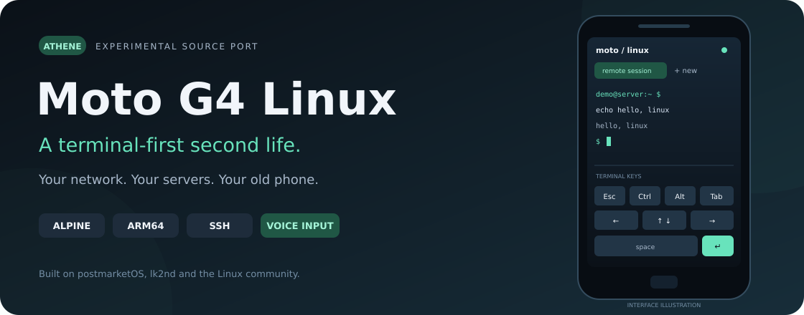
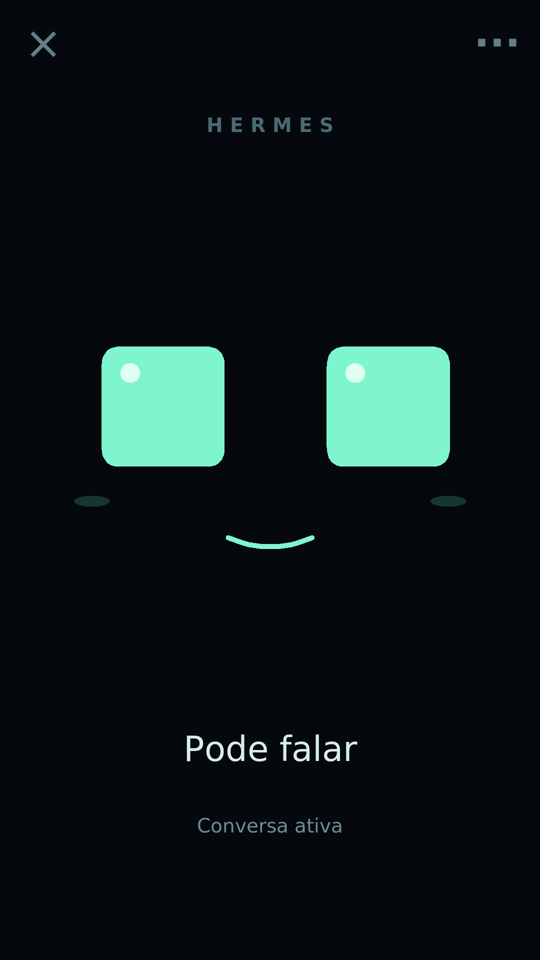
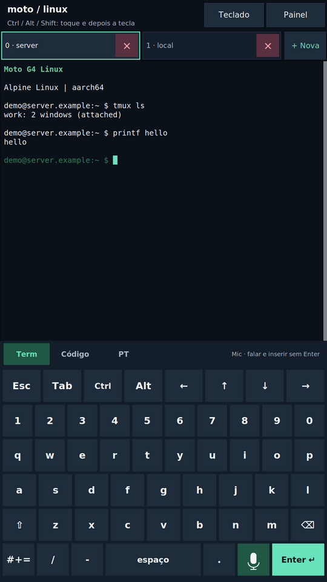
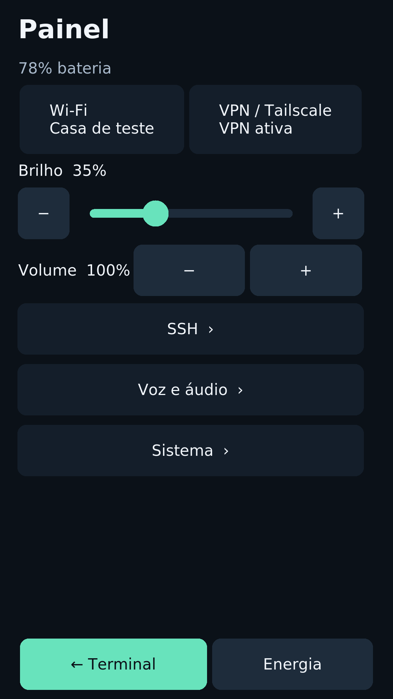

  

# Moto G4 Linux

**Seu Hermes com rosto e voz. Seu terminal Linux sempre à mão.**
Uma segunda vida para o Moto G4 Plus: um companheiro animado em tela cheia e
um terminal de verdade, com teclado de toque, abas persistentes, SSH e Tailscale.
O protótipo usa Alpine Linux, Xorg e xterm/tmux e liga sem um PC.

[Configurar o Hermes](docs/hermes-quickstart.pt-BR.md) ·
[Guia para enviar ao Hermes servidor](docs/hermes-server-agent.md) ·
[Instalar Linux com seu agente](docs/agent-installation.md) ·
[Wiki](https://github.com/holiveiraa/moto-g4-linux/wiki) · [English](README.md)

## Um Hermes vivo no seu celular

Abra **Painel → Hermes**. A interface vira um bichinho de olhos animados.
Diga **“Olá Hermes”**, espere **“Olá! Estou ouvindo.”** e faça seu pedido.
Ele detecta o fim da fala, consulta seu Hermes, responde em voz e volta a ouvir.
Você não precisa tocar num botão nem repetir a ativação a cada pergunta.

  
  
  

São capturas da interface real com dados fictícios em telas virtuais isoladas.
A imagem do Hermes foi capturada no Moto; terminal e painel foram renderizados
em Linux a partir do fonte atual. Não representam uma conversa real já validada.
[Galeria e procedência das imagens](docs/screenshots.md).

- **“Olá Hermes”**: ativação local, somente enquanto o app está aberto.
- **Conversa sem apertar botão**: Groq transcreve as falas após ativação; o
  próprio Hermes usa Edge TTS para responder. A conversa exige internet.
- **Seu agente existente**: usa o perfil escolhido, com uma conversa própria
  do Moto, mantida ao fechar e reabrir. Não se mistura com o Telegram.
- **“Nova conversa”**: muda de contexto sem carregar o assunto anterior nem
  apagar chats antigos. O perfil continua o mesmo.
- **“Voltar a dormir”**: volta a esperar a ativação. **“Voltar ao terminal”**
  ou **“Fechar aplicativo”** fecha o app e libera o áudio. O × também fecha.
- **Login Umbrel preservado**: só senha se você não usa 2FA; código apenas se
  sua conta exigir. Wi-Fi ou Tailscale fornece a rota que você já utiliza.
- **Umbrel sem HTTPS**: use HTTP pelo IP Tailscale e pela porta existente do
  app. O cliente verifica a VPN e restringe HTTP/WS a ela, sem mudar o servidor.

**Estado experimental:** instalado no Moto de referência. O fluxo completo
Groq → Hermes → Edge passou no aparelho com serviços reais e entrada/saída de
áudio sintéticas. Ativação com sua voz, ruído, conversa física e calor/autonomia
ainda precisam de aceitação. [Resultados e limites](docs/status.md#hermes-voice-recovery-and-live-service-chain--installed).

## Configure os dois lados

1. **No Hermes servidor:** envie o texto abaixo. O próprio Hermes confere sua
   versão, faz backup e prepara o perfil/Edge TTS dentro do próprio app.
2. **No Moto:** com os componentes instalados, abra
   **Painel → Hermes → ··· → Configurar**, informe a origem do app (HTTPS ou
   HTTP pelo IP Tailscale), conta e perfil. Configure sua chave Groq em
   **Voz e áudio → Groq** e faça login.
3. **Teste:** diga “Olá Hermes”, espere a confirmação e faça uma pergunta
   simples. Confira a resposta falada, a escuta automática e “Nova conversa”.

**Copie e envie ao seu Hermes:**

> Prepare sua parte para meu app do Moto usando
> https://github.com/holiveiraa/moto-g4-linux. Leia AGENTS.md,
> docs/hermes-server-agent.md e docs/hermes-setup.md. Trabalhe somente dentro
> do próprio app/runtime e dos dados do perfil Hermes. Confira as APIs
> existentes, faça backup e prepare o Edge TTS, preservando meu Telegram.
> Nunca acesse nem altere o host do Umbrel, Docker, gateway, autenticação,
> portas ou serviços. Informe o perfil, a voz, os testes e o que falta testar
> no Moto.

O [tutorial passo a passo](docs/hermes-quickstart.pt-BR.md) explica os campos,
senha com/sem 2FA, certificado, perfil, sessão e primeiro teste.
O [guia do Hermes servidor](docs/hermes-server-agent.md) descreve exatamente
o que ele precisa verificar. **Não precisa instalar um plugin extra quando as
APIs documentadas correspondem à versão instalada.** O gateway Umbrel faz o
login; o app conversa com as APIs do Hermes por trás dessa proteção.

## Um terminal que cabe no bolso

- Teclas Esc, Ctrl, Alt, Tab, setas, repetição e páginas Term/Code/PT com acentos.
- Abas xterm/tmux que sobrevivem ao reinício da interface gráfica.
- Wi-Fi salvo, cadastro Tailscale por QR e favoritos SSH com verificação de chave.
- Senha SSH opcional e entrada manual para senha/2FA.
- Ditado com sua chave Groq: insere UTF-8 no campo ou terminal **sem Enter**.
- Temas Jade, Meia-noite e Papel; brilho, volume, áudio nativo e menu de energia.

O terminal continua útil antes de configurar o Hermes e ao fechar o app.
[Guia de uso](docs/user-guide.md) · [Telas do sistema](docs/screenshots.md).

## Instale Linux com seu agente

**Código experimental para XT1640 / athene P2A, 2 GB / 32 GB.** Não há
instalador universal nem imagem pública pronta. Outro modelo exige investigação.
O kernel é 3.10.108; suspensão, bloqueio de tela, fones/BT/modem e outros modelos
continuam pendentes. [Compatibilidade](docs/status.md).

Abra o repositório no Codex, Claude Code ou agente local e envie:

> Quero instalar o Moto G4 Linux no celular conectado por USB. Leia AGENTS.md
> e docs/agent-installation.md. Inspecione meu aparelho e computador, confirme a
> compatibilidade, prepare backups privados verificados e faça o build. Antes
> de desbloquear, formatar ou gravar, mostre o plano exato e aguarde minha
> autorização. Use minhas próprias chaves e firmware, sem copiar outra identidade.

O [guia para agentes](docs/agent-installation.md) organiza as fases. Cada pessoa
usa suas contas, firmware e chaves; imagens pessoais não são distribuídas.
Se o Linux já funciona no seu Moto, siga somente o
[build/instalação do app Hermes](docs/hermes-setup.md), sem reinstalar o sistema.

## Explore

| Objetivo | Guia |
| --- | --- |
| Começar a conversar com o Hermes | [Tutorial em português](docs/hermes-quickstart.pt-BR.md) |
| Dar instruções ao Hermes servidor | [Guia para o agente](docs/hermes-server-agent.md) |
| Compilar/instalar o app | [Setup técnico](docs/hermes-setup.md) |
| Conhecer referências e decisões | [Pesquisa Hermes](docs/hermes-assistant.md) |
| Usar ou divulgar o sistema | [Galeria de imagens](docs/screenshots.md), [guia de uso](docs/user-guide.md) |
| Instalar a base Linux | [Instalação](docs/installation.md), [build](docs/building.md) |
| Contribuir | [Documentação](docs/README.md), [testes](tests/README.md), [contribuição](CONTRIBUTING.md) |

Código próprio, documentação e arte: MIT, com exceções de kernel/lk2nd em
[LICENSES/README.md](LICENSES/README.md). Veja [créditos](CREDITS.md) e
[avisos](NOTICE.md). Firmware, chaves e dados particulares não são distribuídos.
