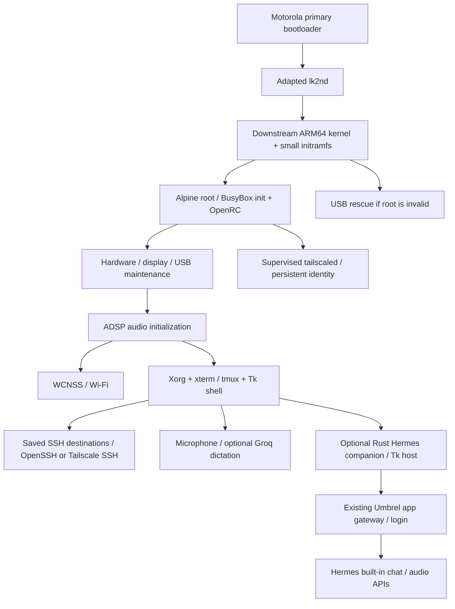

# Architecture

## Layers and source locations

| Layer | Sources | Contract |
| --- | --- | --- |
| Boot hardware selection | `native/lk2nd-motorola-chosen.c` | Preserve firmware-chosen hardware fields |
| Kernel | pinned downstream + `patches/` | ARM64, display/RNG fixes, native DSP playback gain |
| Early/persistent boot | `initramfs/` | Rescue route; no silent formatting |
| Service ordering | `config/moto-*.openrc` | ADSP before WCNSS and desktop/network |
| Input | `native/moto-inputd.py` | Correct contact lifetime and uinput translation |
| UI | `moto-shell.py`, `moto-panel.py`, `moto-widgets.py` | Touch keyboard, focus, scroll, fixed actions |
| Appearance | `moto-experience.py`, `moto-appearance.py` | Built-in palettes, preview/revert, atomic merged preferences and keyboard layouts |
| Terminals | `moto-terminals.py` | xterm/tmux, immutable window IDs |
| Network | `moto-wifi*.py`, `moto-services.py` | Saved profiles, guarded operations, distinct VPN state |
| SSH | `moto-hosts.py`, `moto-ssh-*.py` | Private endpoint-bound credentials, argv, host-key checks |
| Audio/voice | `moto-audio*.py`, `moto-voice*.py`, `moto-quick-voice.py` | Native ALSA; cloud transcription is optional |
| Optional companion | `companion/`, `moto-hermes*.py`, `moto-capture.py` | Rust protocol/state/face/speech, native form focus, shared capture lease; experimental app |

The [companion setup](hermes-setup.md) documents its independent build, private
login, provider setup and pending device acceptance. It uses the existing
Hermes APIs without installing a server plugin when the inspected contracts
match. [Hermes itself prepares its app/profile](hermes-server-agent.md); the
client agent handles only the phone. Umbrel gateway/login/TLS remain in place.

The app is a client of the existing Hermes, not another agent model on the
phone. Its local capture process detects speech without interpreting words.
The network worker sends voiced wake and request clips to Groq; silence stays
local. Accepted wake text activates without contacting the agent. Requests go through the protected
Hermes chat API and replies through its Edge speech relay. The phone owns its
conversation ID in the configured profile. Closing retains it; **Nova conversa**
replaces it after server confirmation. Telegram sessions are not merged.

HTTPS uses normal system/private-CA validation. For HTTP-only Umbrel entries,
`companion/src/tailnet.rs` verifies the local root-owned Tailscale LocalAPI,
running TUN mode and the numeric destination's peer membership. HTTP and WS
sockets bind to `tailscale0` before connecting; each request is guarded and
cannot fall back to ordinary routing. This mode uses the existing VPN and
gateway, with no Umbrel host or TLS/proxy configuration changes.

## Important adaptations

- **Framebuffer:** expose the existing driver device link; use the AsteroidOS
  refresher. Earlier generic fbcon/runtime-PM experiments are not enabled.
- **Entropy:** avoid the vendor FIPS configuration that excluded the normal
  hardware RNG feeder and caused early cryptographic-service stalls.
- **Audio:** initialize ADSP before WCNSS uses the shared reserved memory. Only
  one activation attempt is allowed per boot. The kernel playback patch sets
  the initial DSP Q13 unity gain that Android's HAL previously supplied.
- **Volume:** ALSA softvol stores a global preference. Applications should use
  `default`/`moto_speaker`; direct `hw:0,0` bypasses that control.
- **UI:** mature terminal/key protocols remain xterm/XTest/tmux. The project
  implements touch interaction rather than a terminal emulator or SSH protocol.
- **Focus:** logical destination and native Tk focus are synchronized; event-bound
  focus restoration does not run as a permanent focus-stealing timer.
- **Idle work:** control and worker-completion sockets wake Tk through file
  handlers. Periodic UI work slows when inactive/blanked; header drawing is
  skipped when its visible state is unchanged. A failed transcription does not
  retain a fast recording timer. These changes do not implement suspend.
- **Themes:** the desktop launcher execs xterm with argv from a built-in palette.
  Live OSC color output is restricted to a verified xterm ancestor's tmux client
  tty, never a pane's stdin. Unsaved previews revert on navigation.
- **Dictation:** capture is local; transcription sends the chosen audio to Groq.
  Paste is tied to the intended pane and never submits Enter automatically.

## Private state on an installed phone

| Path | Purpose |
| --- | --- |
| `/etc/wpa_supplicant.conf` | Wi-Fi profiles/credentials, mode 0600 |
| `/var/lib/tailscale/` | This installation's Tailscale identity |
| `/root/.config/moto-linux/hosts.json` | SSH destination metadata |
| `/root/.config/moto-linux/ssh-passwords/` | Optional private endpoint-bound passwords |
| `/root/.config/moto-linux/groq.json` | Optional owner API key |
| `/root/.config/moto-linux/hermes.json` | Optional companion endpoint/account/profile settings |
| `/root/.config/moto-linux/hermes-auth.json` | Optional revocable app session cookie; never clone |
| `/root/.config/moto-linux/hermes-task.json` | Owned conversation ID and uncertain-task marker; no prompt text |
| `/var/lib/moto-audio-volume.json` | Volume preference |
| `/root/.config/moto-linux/ux.json` | Brightness, saved theme and keyboard layout preferences |

These paths are personal configuration, not release inputs. Permission-protected
credential files are not an encrypted vault. See [security](../SECURITY.md).

The optional Hermes view uses an immersive native Canvas with compact animated
Rust vector poses. A separate local-only Rust listener owns ALSA/WebRTC VAD and
a pinned Silero detector through whisper.cpp's VAD API; the main worker alone
handles Groq/Hermes/Edge. No ASR model runs locally. Both wake and conversation
speech produce private upload events after local filtering. Active voice pauses during
network work/playback and resumes automatically after the acoustic tail.
Epoch checks discard abandoned-screen transcription callbacks. See
[design and limits](hermes-assistant.md) for current acceptance limits.
