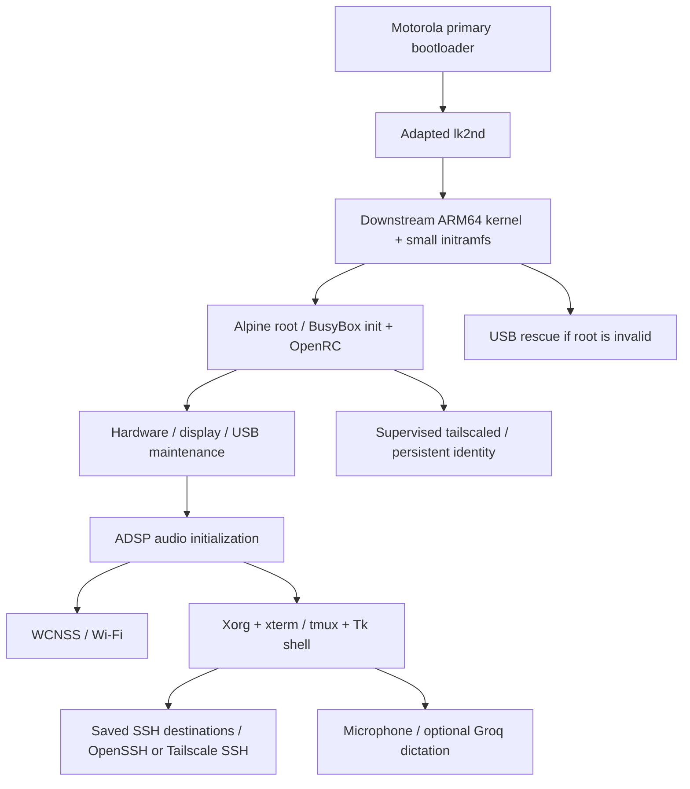

# Architecture

## Layers and source locations

| Layer | Sources | Contract |
| --- | --- | --- |
| Boot hardware selection | `native/lk2nd-motorola-chosen.c` | Preserve firmware-chosen hardware fields |
| Kernel | pinned downstream + `patches/` | ARM64, display/RNG fixes, native DSP playback gain |
| Early/persistent boot | `initramfs/` | Rescue route; no silent formatting |
| Service ordering | `config/moto-*.openrc` | ADSP before WCNSS and desktop/network |
| Input | `native/moto-inputd.py` | Correct contact lifetime and uinput translation |
| UI | `moto-shell.py`, `moto-panel.py`, `moto-widgets.py` | Touch keyboard, focus, scroll, fixed actions |
| Terminals | `moto-terminals.py` | xterm/tmux, immutable window IDs |
| Network | `moto-wifi*.py`, `moto-services.py` | Saved profiles, guarded operations, distinct VPN state |
| SSH | `moto-hosts.py`, `moto-ssh-*.py` | Private endpoint-bound credentials, argv, host-key checks |
| Audio/voice | `moto-audio*.py`, `moto-voice*.py`, `moto-quick-voice.py` | Native ALSA; cloud transcription is optional |

## Important adaptations

- **Framebuffer:** expose the existing driver device link; use the AsteroidOS
  refresher. Earlier generic fbcon/runtime-PM experiments are not enabled.
- **Entropy:** avoid the vendor FIPS configuration that excluded the normal
  hardware RNG feeder and caused early cryptographic-service stalls.
- **Audio:** initialize ADSP before WCNSS uses the shared reserved memory. Only
  one activation attempt is allowed per boot. The kernel playback patch sets
  the initial DSP Q13 unity gain that Android's HAL previously supplied.
- **Volume:** ALSA softvol stores a global preference. Applications should use
  `default`/`moto_speaker`; direct `hw:0,0` bypasses that control.
- **UI:** mature terminal/key protocols remain xterm/XTest/tmux. The project
  implements touch interaction rather than a terminal emulator or SSH protocol.
- **Focus:** logical destination and native Tk focus are synchronized; event-bound
  focus restoration does not run as a permanent focus-stealing timer.
- **Dictation:** capture is local; transcription sends the chosen audio to Groq.
  Paste is tied to the intended pane and never submits Enter automatically.

## Private state on an installed phone

| Path | Purpose |
| --- | --- |
| `/etc/wpa_supplicant.conf` | Wi-Fi profiles/credentials, mode 0600 |
| `/var/lib/tailscale/` | This installation's Tailscale identity |
| `/root/.config/moto-linux/hosts.json` | SSH destination metadata |
| `/root/.config/moto-linux/ssh-passwords/` | Optional private endpoint-bound passwords |
| `/root/.config/moto-linux/groq.json` | Optional owner API key |
| `/var/lib/moto-audio-volume.json` | Volume preference |
| `/root/.config/moto-linux/ux.json` | Brightness preference |

These paths are personal configuration, not release inputs. Permission-protected
credential files are not an encrypted vault. See [security](../SECURITY.md).
