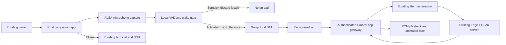

# Hermes companion app: research and implementation

Research updated: **24 October 2026**. Status: **implemented source preview,
fullscreen voice-pet revision built for ARM64 musl; host/native UI and synthetic wake reviewed; installed on the reference Moto; live voice pending**. This document
records primary-source research, repository inspection and a focused Astra
architecture review. The [setup guide](hermes-setup.md) describes the implemented
client and installation boundary. Astra reviewed the design and the local hearing implementation. Static review
identified noise detection, capture continuity and temporary-file cleanup issues;
these were corrected with WebRTC VAD, a bounded capture queue and volatile storage.

## Product decision

Add an **application that opens and closes inside the existing system**. The
owner opens Hermes from the panel, sees an expressive face, speaks to the
existing home-server agent and hears its response. Closing the app returns to
the existing terminal and SSH workflow, with the same tmux windows and panes.

The recommended implementation is a **Rust client/core and software-rendered
face**, a small integration with the existing Python/Tk panel, Groq cloud
transcription using the phone's existing private configuration, and Hermes's
existing Edge TTS service on the server. Start by using the existing Hermes
interfaces. Develop a server adapter/plugin only for a demonstrated gap.

Server preparation is performed by Hermes itself inside its own app/runtime,
following [the server-agent instructions](hermes-server-agent.md) after the
owner provides the published repository. Never access or administer the Umbrel
host. This client work does not change server authentication or restart its
gateway, and does not authorize flashing or formatting a phone.

## Evidence and limits

- The repository documents physical microphone, speaker and Groq dictation
  results on **XT1640 / athene P2A, 2 GB / 32 GB**, Alpine ARM64 and kernel
  **3.10.108**. This research did not repeat those physical tests. See
  [hardware status](status.md) and [architecture](architecture.md).
- Read-only Umbrel MCP inventory reported **Hermes Agent 0.22.4, ready** and
  **umbrelOS 2.0.0, running**, on this research date. This is app/OS inventory,
  not proof of exposed routes, provider configuration or successful login.
  No private host addresses or identifiers are needed in this public plan.
- Upstream Hermes tag `v0.22.4` resolves to
  `4d04303818b61bf3aa09278af48356315515965b` (commit; annotated tag object
  `64dbae64747ab640a3fece06f359307c30d129da`); the audio and chat routes below
  were inspected in that version. The deployed image digest and Umbrel
  modifications still need to be checked before integration.
- Umbrel tag `2.0.0` resolves to
  `9298257b0e904ca8d8270b1702672666343f0b86`; its app authentication and gateway
  sources were inspected. Source availability does not prove live behavior.
- The public app-catalog compose fetched during research referred to image
  `v0.22.2`, while live inventory reported `0.22.4`. Do not replace the installed
  app with that catalog example or assume its ports/digest match this server.
- The WSL build host is Ubuntu 24.04. Rust 1.99.1, Zig 0.15.2 and
  cargo-zigbuild 0.24.0 were subsequently installed in a dedicated local tools
  directory for this preview; pins are in `companion/toolchains.json`.

## Existing projects

### ESP32 reference check — 24 October

The [M5Stack StackChan](https://github.com/m5stack/StackChan) is the ESP32-S3
face/robot family described by the owner. Its small MCU is not evidence that a
general transcription model makes a reliable wake detector. In the current
[Xiaozhi audio architecture](https://github.com/78/xiaozhi-esp32/blob/main/main/audio/README.md),
one input engine owns capture, specialized WakeNet/MultiNet detection and VAD;
output/network queues are independent. [Espressif WakeNet](https://docs.espressif.com/projects/esp-sr/en/latest/esp32s3/wake_word_engine/README.html)
is a trained keyword detector for supported MCUs, not a drop-in Linux model.

[JARVIS Desk Bot](https://github.com/dreamhunter02/jarvis-desk-bot) demonstrates
the requested Hermes integration: local activation, an audible acknowledgment,
server ASR/agent/TTS, and conversation retained until an explicit goodbye.
The useful lessons are explicit activation/turn states, confirmation, persistent
conversation and independent bounded audio queues. Its firmware, extra speech
server and host-service assumptions are not installation instructions for this
project. No new server deployment or copied ESP firmware is required here.

The Moto additionally offers explicit app-open activation: when opted in, opening
the fullscreen app starts acknowledgment and the active conversation. It retains
Groq and the existing protected Hermes/Edge APIs. Local “Olá Hermes” accuracy is
still a separate, unaccepted capability; opening activation is not reported as
a successful wake-word test.

| Project | What exists | Fit for this phone |
| --- | --- | --- |
| [Hermes Familiar](https://github.com/webdevtodayjason/hermes) | ESP32-S3 touch face, native Hermes plugin, live state, actions and approvals; USB, TCP and WebSocket transports | Closest to the described face/plugin concept. The documented audio is chirps, not a demonstrated complete Groq/Edge conversation pipeline. Its broad session broadcast and optional transport token must not become this app's defaults. |
| [JARVIS Desk Bot](https://github.com/dreamhunter02/jarvis-desk-bot) | ESP32 robot, xiaozhi voice server, Hermes API integration, speech progress and background jobs; documented Parakeet/Kokoro stack | Closest complete physical voice-agent example found. Reuse architectural lessons; its ESP firmware, local speech models and systemd job assumptions do not match Alpine/OpenRC or this requested Groq/Edge path. |
| [Xiaozhi ESP32](https://github.com/78/xiaozhi-esp32) | Voice-device firmware, expressive displays, wake word, Opus and network protocols; full duplex on supported audio hardware | Useful interaction/protocol reference. It is not a Hermes client ready to install on native Moto Linux. Porting an ESP hardware layer is unnecessary here. |
| [Hermes Live Voice](https://github.com/bielcarpi/hermes-live-voice) | Community plugin/gateway and dashboard voice UI, background-task receipts, OpenAI Realtime/Gemini/local providers | A useful reference for reconnects and task lifetime. Its Node/browser/realtime stack adds dependencies and does not directly supply the requested lightweight Groq/Edge client. Managed local voice requires Apple Silicon and substantial RAM. |
| [Hermes voice support](https://hermes-agent.nousresearch.com/docs/user-guide/features/voice-mode) | Built-in Groq STT, Edge TTS and remote voice routes | Preferred server-side reuse. Verify the installed configuration rather than installing another voice stack first. |

These are upstream descriptions/source observations, not independent hardware
verification. No upstream firmware, portrait assets or plugin code was copied.
Preserve original licenses and add attribution/pins if implementation reuses any.

## Data flow



Groq remains an external cloud service; capture and key storage on the phone do
not make recognition local. Edge TTS also requires internet access. If either
provider fails, retain a usable text conversation and an honest error state.

### Native app and existing shell

- Add a panel launcher, provisionally **Hermes**, and one app instance. The
  terminal session is not replaced, respawned or used as a command transport.
- Rust owns the state machine, network/speech workers and CPU face rasterizer.
  The fullscreen revision sends compact animated vector poses to a native Tk
  Canvas; no dashboard, chat bubbles or push-to-talk button occupies the main view.
  This replaces the initial SDL2-window proposal and reuses established focus
  and keyboard handling without adding a second graphics toolkit. No GPU or
  direct framebuffer access is required. A separate Rust listener owns ALSA capture and local wake recognition.
- The face has disconnected, connecting, ready, listening, transcribing,
  thinking, speaking, awaiting-confirmation and error expressions. Animation
  follows actual events, not a timer pretending that work completed.
- Open the app, say **Olá Hermes**, wait for its spoken acknowledgment, then
  converse without touching the screen. Each answer automatically returns to
  listening. **Nova conversa** changes context; **Fechar aplicativo** returns to
  the terminal. A discreet menu/long press provides setup and recovery controls.
- Configuration and editable transcript fields remain in the existing Tk panel,
  using `DevicePanel.field/register_input`, including `Text` editors. Keep the
  existing caret, selection, focus border and touch keyboard behavior.
- Launch/return must explicitly coordinate shell keyboard visibility and focus.
  A Rust window alone does not suspend the shell's XTest delivery to xterm.
  Test that app buttons and secrets cannot send terminal keystrokes.
- Closing stops local capture/playback, invalidates callbacks and exits only
  owned workers. Default: an already accepted Hermes task can continue; reopening
  reconciles it. Closing, stopping speech and cancelling work remain distinct.
- Hidden/closed apps do not listen or animate. Screen blanking stops capture
  and playback and invalidates queued speech. It remains backlight blanking,
  not suspend or a lock. Returning does not replay old audio automatically.

Rust is appropriate for the new application. Rewriting the existing shell,
Hermes's Python internals or the maintained Edge client is unnecessary. A small
Tk integration is part of preserving the owner's working system.

### Audio and Groq

Keep the proven initial capture contract: `arecord`, **48 kHz / S16_LE / mono**,
bounded duration, private temporary files under `/run`. Use subprocess argument
arrays and bounded process shutdown. Never send secret text through argv.

Use `whisper-large-v3-turbo`, language `pt`, and the existing private Groq key
schema without copying it into the repository or server. Read the key only in
the private worker. [Groq's documented endpoint](https://console.groq.com/docs/speech-to-text)
accepts WAV and downsamples for recognition. Optional local resampling is a
later measured optimization, not a reason to change a working PCM route now.

Both existing dictation and the Rust listener use the same private inherited
`flock` lease at `/run/moto-capture.lock`. Closing terminates only owned capture,
recognition and playback processes. Dictation keeps its UTF-8/no-Enter contract.

The accepted interaction uses local activation and automatic half duplex:

1. While the app is open and connected, WebRTC VAD filters native 48 kHz frames.
2. Silero verifies candidate speech; a pinned multilingual Whisper base q5_1
   helper checks it locally
   for the whole normalized phrase **Olá Hermes** with probability/no-speech
   thresholds. It receives only a proper-name spelling hint, never a forced
   phrase or previous transcript prompt. Repetitions of only the wake phrase
   count as one activation. Its model is released after activation.
3. The activation recording is discarded, including any extra command spoken
   in that same utterance. **Nothing from standby is uploaded to Groq.**
4. After spoken acknowledgment, automatic end-of-speech emits a private bounded
   WAV for Groq. No button and no repeated wake word are needed for each turn.
5. Capture is paused during transcription, Hermes work and speech playback.
   After playback completes, a 400 ms acoustic tail precedes listening again.
6. **Voltar a dormir** returns to local activation. Closing/blanking stops all
   local hearing. No voice barge-in/AEC is claimed in this revision.

Wake capture continues while local inference runs, retaining only one latest
candidate (maximum five seconds), replacing obsolete queued audio. Active
utterances have a 45-second bound. `/run` directories are created 0700 and WAVs
0600; normal shutdown and parent cleanup after forced termination remove them.
No background service or cloud wake fallback exists. Never restart ADSP/WCNSS
as an audio retry. Existing volume/default speaker routing is preserved.

### Wake engines and animated-device research

Research refreshed 22 October 2026, using primary project documentation:

| Candidate | Evidence and decision |
| --- | --- |
| [Xiaozhi ESP32](https://github.com/78/xiaozhi-esp32) | Offline wake, animated displays and conversation loop inform the product. Source inspected at `7e69845d818553ac045efbcde746b22bef6eecf6`. ESP-specific firmware is not ported. |
| [RoboEyes](https://github.com/fluxgarage/RoboEyes) | Blink/gaze/emotion reference, inspected at `b42f8e596535234932be3514ac7a813d4ced0046`. GPL-3.0 code/art is not copied: this app uses original vector geometry. |
| [openWakeWord](https://github.com/dscripka/openWakeWord) | Upstream models support English; code Apache-2.0, bundled weights CC-BY-NC-SA-4.0. No ready Portuguese “Olá Hermes” model was established. |
| [sherpa-onnx KWS](https://k2-fsa.github.io/sherpa/onnx/kws/index.html) | Existing KWS models target English/Chinese. Open vocabulary does not establish Portuguese support. |
| [Vosk](https://alphacephei.com/vosk/models) | Portuguese small model is 31 MB, Apache-2.0. Grammar cannot introduce an unknown proper noun; musl/Kaldi packaging adds work. |
| [whisper.cpp](https://github.com/ggml-org/whisper.cpp) | Multilingual CPU/ARM implementation, MIT. Chosen for the first measurable local Portuguese experiment; not a specialized low-power wake engine. Exact source/model hashes are in `companion/wake/pins.json`. |
| [microWakeWord](https://github.com/OHF-Voice/micro-wake-word) | Apache-2.0; attractive low-compute future route, requiring a trained and evaluated Portuguese model. No ready model was verified. |
| [WebRTC VAD Rust binding](https://github.com/kaegi/webrtc-vad) | Pinned 0.4.0 wrapper over libfvad, 48 kHz/20 ms frames; filters speech rather than relying on loudness alone. Wrapper/upstream licenses stay separate. |

**Acceptance still required:** actual-owner pronunciation, distance/accents,
TV/music/silence false activations, latency, missed wakes while busy, memory,
CPU, heat and battery on the old phone. A successful build or synthetic speech
sample does not establish an acceptable wake word. No always-listening claim
applies outside the open app.

### Hermes conversation and Edge TTS

Inspected upstream `v0.22.4` includes:

| Interface | Intended use | Required proof |
| --- | --- | --- |
| `/api/ws` | JSON-RPC gateway conversation/events | Authentication, initialization, Moto-owned session, event filtering, request receipts and cancellation in the installed image |
| `/api/audio/speak-stream` | Text frames in; start metadata, binary int16 PCM, end frames out | Authenticated WS through Umbrel, actual sample rate/channels, provider availability, bounded buffering and prompt stop |
| `/api/audio/speak` | Full synthesis as an audio data URL | MIME/codec check; an MP3 data URL cannot simply be passed to `aplay` |
| `/api/audio/transcribe` | Server-side STT alternative | Requires server STT configuration; not needed to reuse the phone's Groq key |

Sources: pinned [chat routes](https://github.com/NousResearch/hermes-agent/blob/4d04303818b61bf3aa09278af48356315515965b/hermes_cli/web_routers/chat_ws.py)
and [audio routes](https://github.com/NousResearch/hermes-agent/blob/4d04303818b61bf3aa09278af48356315515965b/hermes_cli/web_routers/audio.py).
These are versioned implementation contracts, not a promise that all future
dashboard builds expose identical interfaces.

Prefer `speak-stream`: this version implements a sentence-based Edge fallback
that decodes audio on the server and sends PCM. The Moto follows returned rate
metadata and uses ALSA conversion as needed; do not assume 48 kHz downlink just
because capture uses that rate. Version one can submit the final response as
text plus `done`; sentence streaming can then reduce perceived latency.

Do not change the owner's global voice/model settings silently. Confirm whether
Edge is already selected and its dependencies exist inside the managed image.
If enabling it would alter Telegram behavior, use a supported per-profile or
per-request configuration, or a narrowly scoped adapter as a separate change.

[edge-tts](https://github.com/rany2/edge-tts) accesses the online Edge speech
service without requiring the Edge browser. Hermes documents it as a free,
no-key provider. This does not establish a paid API contract, guaranteed uptime
or permanent free availability. Discover available pt-BR voices at setup.
Never silently switch to a paid provider. Text still works if speech fails.

Use the existing Hermes agent/tools/memory with a **separate Moto conversation**.
Do not silently attach to, modify or read aloud the Telegram conversation.
Only user-visible assistant text for the active Moto session is speech input;
exclude reasoning, raw tool output, credentials and unrelated notifications.

The [Runs API](https://hermes-agent.nousresearch.com/docs/user-guide/features/api-server)
is a fallback if the authenticated gateway path is unsuitable. It requires a
separately enabled/authenticated API service and verified run/session ownership.
The catalog's dashboard proxy does not establish that port 8642 is published.
Do not open it, run a second gateway or bypass Umbrel as an implementation shortcut.

## Umbrel 2.0 authentication: implemented protocol

There are **two boundaries**: Umbrel app access and Hermes's own request/WS
authorization. A Hermes Bearer token does not by itself satisfy Umbrel app
access. Tailscale connectivity also does not authorize the application.

The [Umbrel Hermes wrapper](https://github.com/getumbrel/hermes-agent-umbrel)
supports `HERMES_UMBREL_APP_PROXY_AUTH=1`, relying on outer Umbrel protection.
Its [auth patch](https://github.com/getumbrel/hermes-agent-umbrel/blob/2f12a5fde45955d2c62f1ac06fbb22f28710ea65/patch-umbrel-proxy-auth.py)
explains why exposing the internal service directly would remove that boundary.

The **2.0.0 source** supplies a browser app-login protocol that a native HTTP
client can implement without running Chromium on the phone:

1. Discover the actual app-entry URL and follow only validated Umbrel login
   redirects. Preserve the app ID, origin and redirect path. Accept only the
   configured auth origin (default: same hostname, port 2000, from the inspected
   2.0 source). Never accept an arbitrary redirect port or an obsolete
   `UMBREL_PROXY_TOKEN` cookie.
2. Show account/password, and 2FA if required, using existing private Tk forms.
   The owner enters credentials **on the phone**, never in chat. Freeze the
   server/account target for the attempt and discard results after target change.
3. Submit to the discovered auth origin's `/v1/account/login`, carrying the
   required app query parameters. The 2.0 handler accepts `userId`, `password`
   and optional `totpToken`; preserve missing/wrong 2FA and access-denied states.
4. Validate the returned handoff destination against the configured Umbrel/app
   origin and POST the one-use `handoff` and redirect field as form data to
   `/umbrel_/api/v1/auth/handoff`. Never forward credentials to arbitrary
   redirects or put them in query strings.
5. Retain the resulting app-gateway cookie in a private jar and present it on
   both REST requests and WS upgrades. Use only this app's endpoints. The
   upstream gateway strips Umbrel cookies before forwarding to the application.
6. Satisfy any remaining Hermes token/ticket requirement exposed by that image;
   verify the complete chain with a harmless session before voice integration.

This protocol is covered by **synthetic password-only and 2FA integration
fixtures, not a live owner-account login result**.
Pinned sources: [app login/handoff](https://github.com/getumbrel/umbrel/blob/9298257b0e904ca8d8270b1702672666343f0b86/packages/umbreld/source/modules/server/app-auth.ts),
[app gateway and WS checks](https://github.com/getumbrel/umbrel/blob/9298257b0e904ca8d8270b1702672666343f0b86/packages/umbreld/source/modules/app-gateway/app-gateway.ts),
and [cookie handling](https://github.com/getumbrel/umbrel/blob/9298257b0e904ca8d8270b1702672666343f0b86/packages/umbreld/source/modules/auth/app-gateway-cookie.ts).

Verify server TLS/identity before sending the password. Follow the installed
Umbrel certificate trust mechanism; never disable certificate validation. LAN
and Tailscale hostnames need explicit identity/endpoint validation, and a Secure
cookie must not be downgraded onto ordinary LAN HTTP. Do not copy browser
cookies manually as the product's onboarding workflow.

Do not persist the password or TOTP. A remembered session, if enabled, is a
revocable account credential and may access other apps shared with that account;
it is **not inherently limited to Hermes**. Keep its file owner-only, bind it to
the server/account, expose Forget session, and clearly state that this root
desktop has no encrypted credential vault. Expiry/revocation returns to login.
Do not reuse this chat's Umbrel MCP token as an app credential.

Umbrel also has native-client grants (`user.loginNative`), but the inspected app
gateway authenticates app cookies. A native grant must not be assumed to open
the app directly. Hermes's [native PKCE sign-in](https://hermes-agent.nousresearch.com/docs/guides/desktop-native-signin)
is another independent flow: its loopback callback targets the browser's host,
so showing its URL as a QR on a different phone does not solve onboarding.

If installed behavior differs, implement a version-specific auth adapter from
verified source/fixtures. A new server bridge needs an explicit authentication
and deployment design; putting it behind the same gateway alone does not solve
client login. Do not disable proxy auth, whitelist all `/api/*`, weaken TLS or
change Tailscale/SSH policy to make the prototype work.

## Rust feasibility gate

Build on the Linux filesystem in WSL, outside the synced checkout. Pin the
toolchain, dependency versions/features and `Cargo.lock`. Target generic
ARMv8-A `aarch64-unknown-linux-musl`, not `target-cpu=native`.

The [Rust target documentation](https://doc.rust-lang.org/rustc/platform-support/aarch64-unknown-linux-musl.html)
does not establish support for this particular downstream kernel. Do not apply
the GNU target's documented kernel minimum to musl as proof of incompatibility.
Audit transitive syscall/CPU requirements and test on the **real kernel**:
threads, mutexes/channels, monotonic clock, filesystem, OS randomness, DNS/TCP,
certificate verification and a complete TLS handshake, then the Rust/Tk UI
and ALSA. QEMU user mode on a modern host does not validate the old kernel.

For example, [getrandom](https://docs.rs/getrandom/latest/getrandom/) documents
fallback behavior for Linux; optional `linux_getrandom`/`linux_raw` backends
raise the kernel requirement. Audit the selected version/features instead of
assuming all Rust RNG is incompatible. Choose the TLS crypto provider explicitly
and test its actual ARM build. No `io_uring` dependency or insecure RNG/TLS workaround.

The implemented UI uses original Rust software rendering hosted in Tk; SDL2
was an initial candidate, not a shipped dependency. Measure RSS/PSS, CPU, frame
time, startup, heat and idle behavior on the phone before making performance
claims.

## TDD contracts and delivery sequence

Write failing behavior tests, implement the minimum, then refactor. Network,
clock, randomness and audio backends must be replaceable with deterministic
fixtures. Unit tests do not contact Groq, Microsoft, the owner's Hermes or SSH.

| Stage | Deliverable | Acceptance gate |
| --- | --- | --- |
| 0. Feasibility and auth | Pinned Rust smoke binary; sanitized Umbrel 2.0/Hermes 0.22.4 fixtures; exact installed image/route map | Real-kernel runtime checks when authorized; mock login/2FA/handoff/expiry/revocation and both WS auth layers; protected endpoint remains protected |
| 1. Offline app | Pure Rust state/protocol core and demo face with fake events | Open/close/reopen, process ownership, stopped/unknown/error states, no stale callbacks or terminal key delivery |
| 2. Conversation | Auth adapter, Moto session, text submission, reconnect/cancel | One logical utterance cannot create duplicate work; wrong-session events rejected; accepted work reconciled after disconnect |
| 3. Audio | Shared mic lock, bounded capture, Groq adapter, existing Edge PCM stream | Existing dictation preserved; no self-transcription; text remains on TTS failure; playback stop and buffer bounds |
| 4. Integration | Panel launcher/forms, isolated Xvfb/tmux review, rollback package | Repeated open/talk/hear/close with immutable tmux IDs and original SSH session retained; synthetic form secrets never enter PTY |
| 5. Physical acceptance | Owner-approved userspace deployment and Wi-Fi/Tailscale trials | Portuguese speech intelligibility, actual mic release, volume, reconnection, server-auth expiry and measured resource use |
| 6. Required voice-pet UX | Fullscreen face, local wake, automatic endpointing and new-conversation command | Host fixtures pass; native wake accuracy/latency/heat and physical acceptance remain required |

Essential adversarial cases before the happy path is declared complete:

- Close or change server/account while transcription/login/TTS is in flight;
  late results cannot authenticate, paste, dispatch or play into a new context.
- Silence, oversize/truncated WAV, stalled capture, ALSA busy, 401/403/429,
  malformed JSON, oversized audio, invalid PCM metadata and server restart.
- Two capture clients; child crash or cancellation; ownership persists until
  the capture child is reaped. An app-only lock is not sufficient.
- Disconnect after server acceptance but before the reply. Keep stable request
  identity and use **verified server deduplication**. JSON-RPC correlation IDs
  alone do not prove idempotency. Never resend uncertain agent work under a new
  ID; surface unknown outcome and reconcile by receipt/session state.
- Session/event mixups, duplicated/reordered events and replay after reopen.
  Distinguish speech stop, requested task stop and confirmed task completion.
  Cancellation cannot undo effects already performed by tools.
- No automatic spoken approval. Version one can direct approval to the existing
  authorized Hermes UI; later touch approvals require exact session/run/prompt
  identity, execution generation and validity checks, with reject/replay tests.
- Auth redirect to an untrusted host, expired/replayed handoff, wrong account,
  certificate change, stale cookie and WS connection after session revocation.

Proposed source boundaries: `companion/` Rust workspace with `core`, `transport`,
`audio` and `face` modules; a small panel/launcher integration under `native/`;
sanitized protocol fixtures and cross-language microphone-lock regressions under
`tests/`. Keep deployment helpers separate from builds. Add no startup daemon
or always-on microphone by default. Exact crate versions follow the stage-0
runtime/dependency spike, not speculation in this plan.

Run `cargo test --locked`, formatting/lints and mock-server integration checks
when the Rust implementation exists. Also run both repository gates on Linux:

```sh
python3 scripts/check-repository.py
python3 scripts/run-tests.py
```

Follow [isolated review instructions](../tests/README.md) for GUI/PTY checks.
Before deployment, prepare input hashes, verified userspace backups, exact file
destinations, owner-visible impact and rollback. No boot/partition/firmware
changes are needed for the planned app. Server plugin installation, voice
configuration changes and service restarts remain separate deployment actions.

## First implementation slice

Start with the offline Rust state machine and a fake-server face that opens and
closes cleanly, alongside sanitized authentication fixtures. In parallel as
ordinary engineering work, resolve the runtime/auth gates before connecting
real accounts. Then add one typed Hermes round trip, one recorded utterance,
and one spoken answer, in that order. This produces reviewable increments
without making a working terminal depend on an unfinished voice assistant.

## Initial planning checkpoint (historical, before implementation)

On 22 October 2026, a Linux-filesystem copy containing only public candidate
files passed `scripts/check-repository.py` and all **101 existing offline tests**
through `scripts/run-tests.py`. The Wiki exporter generated **19 files locally**,
including this plan. No source or Wiki content was published. No new Rust tests,
live login, speech-provider call, device deployment or physical acceptance test
was performed at that planning checkpoint. This paragraph is historical, not
the current publication/deployment state; see the implementation evidence below
and [current status](status.md).

## Implemented preview and remaining gates

`companion/` contains the Rust client, lockfile, original face renderer, private
JSON process protocol and offline fixtures. `native/moto-hermes*.py` integrates
with the existing panel and capture lease. No server plugin is required by the
inspected API contract. The GUI supports password-only accounts and requests a
2FA code only when challenged; it does not change account security settings.

Before speech, the client inspects the authenticated profile voice verdict and
requires the exact Edge relay verdict from v0.22.4. Unknown/paid providers or a
disabled `voice.client_direct` verdict leave the reply in text. The verdict is
never logged or saved because other providers can include API keys. A server
configuration change racing this check still needs server-side coordination;
keep the selected profile fixed during a conversation. See the pinned
[resolver](https://github.com/NousResearch/hermes-agent/blob/4d04303818b61bf3aa09278af48356315515965b/tools/voice_client_config.py).

Host and native-device evidence is recorded in [status](status.md). The ARM64
runtime smoke, isolated Rust/Tk review and all 19 Rust fixtures passed on the
reference kernel 3.10 after USB reconnection, including loopback HTTPS/WSS. The
frontend was installed with verified rollback and the existing tmux window
preserved. Physical conversation, the installed server image/auth flow, the
owner's endpoint/CA, live Groq/Edge and fresh-install acceptance remain open.

## Live API compatibility correction — 23 October 2026

The actual authenticated dashboard advertised no canonical authority and refused
`session.create` with code `4000`; it exposed the legacy contract even though
app-local inspection had found the canonical contract in the same version.
The client now waits for `gateway.ready` and selects the corresponding adapter
before sending mutations. Both contracts have strict fixtures; no failed prompt
is retried against a different API. Canonical creation omits the title because
the authority resolves existing titles before considering the idempotency key.
Protected login/session creation is now confirmed on the reference phone.
See [current contracts](hermes-server-agent.md#contracts-the-moto-expects) and
[acceptance evidence](status.md#hermes-gateway-compatibility-and-rpc-diagnostics--installed).

## Fullscreen revision checkpoint

The earlier panel prototype was rejected during owner review. Its installed
seven-file build is a historical checkpoint, not proof that the new voice-pet
revision is deployed. The replacement has a fullscreen original animated face,
local wake listener and exact spoken commands. Current host evidence: **115
Python regressions**, **28 Rust tests**, Clippy, ARM64 compilation and isolated
1080×1920 Tk/XTest/tmux review. All 28 Rust tests, 14 Python companion tests and
the fullscreen review then also passed directly on the Moto. The native synthetic
wake benchmark completed. After scoped Windows USB-device recovery, the complete
package was verified, installed transactionally and independently checked;
model startup and GUI restart passed with production tmux `@0` preserved.
Actual-owner microphone/noise and live Hermes/Groq/Edge acceptance remain open.
See [status](status.md) for USB recovery/deployment evidence.

### Synthetic host wake experiment

The persistent x86_64 helper was exercised with eight offline synthetic pt-BR
utterances (Microsoft Maria), never an owner's recording. Decode times were
1.07–1.28 seconds on the build host, **not Moto latency**. The two wake samples
produced “Ola Hermes” (average token probability 0.482) and “Ula Hermes” (0.497).
The initial 0.55 cutoff rejected both. The experimental whole-phrase cutoff is
0.40 for the exact normal phrase. A subsequent native experiment reproduced
the same two outputs; the one explicitly measured phonetic variant **Ula Hermes**
is accepted at 0.45. No broad fuzzy matching is used. Both known positives and
six unrelated negatives now satisfy this tiny fixture, which is **insufficient
acoustic evidence**, not wake acceptance. The probability is an uncalibrated model score, not a measured confidence
that the owner spoke. A larger real positive/negative corpus and native latency
measurements must justify any threshold/model change before calling this ready.

### Native synthetic wake experiment

The same eight synthetic pt-BR samples ran directly on the reference Moto,
without microphone capture or cloud calls. Persistent-helper startup took
0.261 seconds; each decode took **1.326–1.906 seconds** (wake samples 1.447 and
1.557 seconds). Resident memory was approximately **78 MB**, peak approximately
81.5 MB as reported in `/proc`. This measures this helper/corpus, not complete
wake-to-answer time or idle battery/heat. Initial VAD silence and network/TTS
latency are additional. The strict full-utterance gate includes the measured
“Ula Hermes” variant; thresholds remain experimental and tuned on this small
synthetic corpus. Physical owner-speech/noise acceptance remains mandatory.
The USB link completed the transfer after pacing it in small blocks; no network
policy or service was changed.
