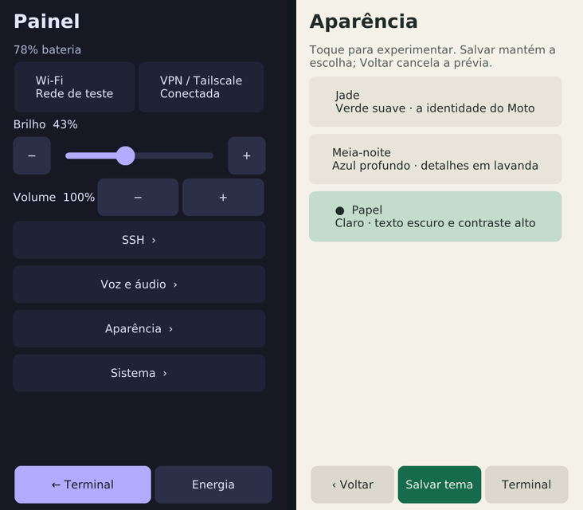

# Alpine interface refresh

Implemented and tested on **22 October 2026**, on the existing **Moto G4 Plus
XT1640 / athene P2A, 2 GB / 32 GB**. This is a userspace update to the Alpine
prototype, not a new flashable release or a fresh installation validation.

This is the dated 22 October theme review, before the Hermes launcher was
added. For current face, terminal and panel images, use the
[screenshot gallery](screenshots.md).

## Included

- **Integrated appearance:** **Panel → Appearance** offers Jade, Midnight and Paper palettes for panel,
  keyboard and xterm. Preview is reversible; saving is explicit. Palette data
  is built in, with no downloaded theme scripts, blur or continuous animation.
- **Keyboard pages:** Terminal, Code and Portuguese; brackets/operators or
  Portuguese accents/ç, while preserving modifiers, navigation, focus and caret.
- **Less idle work:** cached header drawing, slower inactive/blanked polling,
  and event-driven control/worker callbacks. A retry state no longer keeps a
  recording-speed polling loop. Wake bookkeeping survives tmux timeouts.

The terminal retains its direct tab and keyboard controls and the four-tab limit.
Optional fzf/ripgrep CLI binaries remain installed on this prototype, without GUI
integration or background services. They are not required packages for a fresh
basic GUI installation.

## Evidence

**101 offline tests passed** on Linux/WSL in an isolated copy of public source.
The new tests check merged private preferences, invalid/corrupt defaults, fixed
palette/xterm argument data, contrast and accented keyboard coverage.

On the Moto, the new real Tk/XTest/PTY review uses Xvfb `:9`, a private xterm/tmux
server, synthetic hosts/preferences and a fake backlight. It verifies:

- theme preview/back/save, brightness preserving theme choice and live color
  output never appearing in the pane's stdin;
- native form focus, masked accented input and no menu-input fallthrough;
- literal UTF-8 PTY input without Enter and readable/reachable controls;
- direct panel access to Appearance, with no action-menu or draft shortcuts;
- cached header drawing, worker completion while blanked, malformed control
  datagrams, prompt socket wake and tmux failure during wake.

Existing isolated reviews also passed for input/caret, terminal tabs,
connections, voice review, quick dictation and Tailscale authorization states.
These do not operate on the owner's active terminal as a typing/close fixture.

## Short idle comparison

Before the final UI simplification, two sequential **20-second** samples compared
the previous and candidate shell
on the same physical Moto and Xvfb display, with one private idle terminal,
synthetic awake state and the network worker disabled in both. Startup was
excluded. CPU is expressed as a percentage of **one CPU core**; memory is PSS.

| Observation | Previous shell | Candidate shell |
| --- | --- | --- |
| Python shell CPU | 11.55% | 1.70% |
| Python shell PSS | 22,632 KiB | 21,997 KiB |

This is evidence of reduced work in that shell scenario. It does **not** measure
total-device power, display/input-daemon consumption, long-term thermals, loaded
development sessions or unplugged battery life. Blanking the backlight still
does not suspend or lock Linux. A power-management investigation remains separate.

## Deployment and recovery

The userspace update checked source hashes before activation and installed
hashes afterwards. A readable archive of
the previous files and UX preferences was verified by matching SHA-256 on device
and host. Activation used `moto-ui-control`; the existing tmux window ID survived.
No raw partition, boot image, firmware, Tailscale identity or SSH-policy write
was part of this update. The owner observed the updated interface.

fzf's version/filter and ripgrep's line-number search passed on the installed
system. The isolated test display was stopped; the owner's tmux window remained
present. Theme and keyboard ergonomics still need normal physical acceptance.

Private backups, raw measurements, device identity and rollback manifests stay
with the owner. Future updates should first follow [testing](../tests/README.md)
and retain the installation's own rollback files. See [usage](user-guide.md) and
[hardware status](status.md) for behavior and remaining limits.
