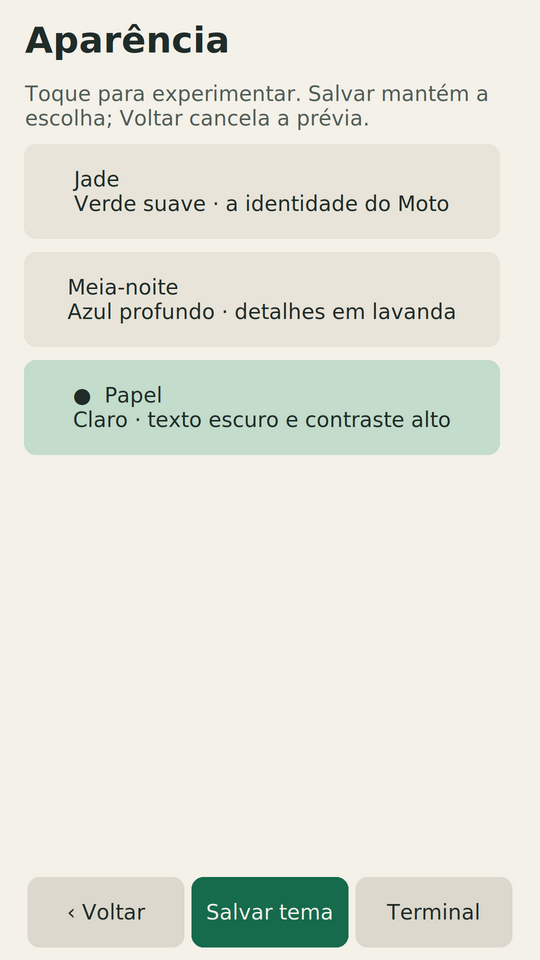

# Interface gallery and sharing

The project has two everyday modes: a **fullscreen Hermes voice companion**
and a **native Linux terminal**. These images show the real application
rendering with synthetic data. They are suitable for describing the interface;
they do not establish an accepted live agent conversation or a new-device boot.

## Hermes and the terminal

| Hermes fullscreen face | Terminal, tabs and keyboard |
| --- | --- |
|  |  |

Open **Painel → Hermes**, say **Olá Hermes**, wait for acknowledgment and talk.
**Nova conversa** changes the Moto's context; **Voltar ao terminal** closes the
app. [Connect your agent](hermes-setup.md#first-connection-checklist) /
[tutorial em português](hermes-quickstart.pt-BR.md) /
[instructions to give Hermes itself](hermes-server-agent.md).

The terminal uses xterm/tmux with real Esc/Ctrl/Alt, tabs, arrow/repeat keys and
Term/Code/PT keyboard pages. Sessions remain when the GUI restarts.

## Controls and appearance

| Home panel, including Hermes | Paper appearance preview |
| --- | --- |
|  |  |

## Saved connections

| Wi-Fi | SSH |
| --- | --- |
|  |  |

## Capture provenance

| Asset | Capture / source | What it demonstrates |
| --- | --- | --- |
| `hermes.png` | 22 Oct 2026, isolated 1080×1920 Xvfb on the reference Moto XT1640; published at 540×960 | Real Rust vector poses/native Tk canvas, with synthetic connection/voice events. No live account or microphone acceptance. |
| `terminal.png`, `panel.png`, `appearance.png` | 23 Oct 2026, Ubuntu 24.04 disposable container, private 1080×1920 Xvfb/tmux; published at 540×960 | Current Python/Tk/xterm UI. Fixed demo output and fake network/battery/volume; no actual SSH destination, account or device state. |
| `wifi.png`, `ssh.png` | 21 Oct 2026, isolated Xvfb on the reference Moto, synthetic fixtures | Connection layouts with fake networks and reserved example hosts. |
| `experience.png` | 22 Oct 2026, reference Moto isolated review | Historical Midnight/Paper comparison for the [interface refresh report](interface-refresh.md); its panel predates the Hermes launcher. |
| `input-focus.png` | Isolated native form/caret review | Small technical crop for input diagnostics; not a promotional overview. |
| `banner.svg` | Original self-contained SVG artwork, refreshed 23 Oct 2026 | Stylized face/terminal illustration. Not a device photo or screenshot. |

Preview images have no real network names, private IPs, keys, cookies,
transcripts or identifying notifications. Recordings and raw owner diagnostics
must stay private. The UI is in Brazilian Portuguese; captions/guides can be
translated without changing the screenshots.

## Reproduce the current terminal and panel captures

Use a **disposable Linux container with an empty home and its own Xvfb**.
Do not run captures on a person's desktop or active Moto session. Install
`python3-tk`, `xvfb`, `xterm`, `tmux`, `xdotool`, `x11-apps` and
`fonts-dejavu-core` inside that container. Copy or mount only public source,
then run from its repository root:

```sh
MOTO_SHOWCASE_ISOLATED=1 xvfb-run -a \
  -s '-screen 0 1080x1920x24 -nolisten tcp' \
  python3 scripts/capture-interface.py --output /tmp/moto-showcase
```

This runs the current UI with a private control socket, fake backlight,
temporary preferences/accounts and an isolated tmux server. The terminal
prints fixed example output; it does not connect to SSH, Hermes, Groq or audio
hardware. Cleanup stops only its own terminal/tmux processes. Review the XWD
captures before converting them to PNG. The published previews use a 50%
resize, with no controls redrawn, removed or added.

For the real Rust face with synthetic service events, follow
[`review-hermes.py`](../tests/review-hermes.py) and the
[isolated review instructions](../tests/README.md). Build its host Rust binary
first; `MOTO_HERMES_REVIEW_OUTPUT` selects a private output folder. This is
an interface review, not an end-to-end speech-provider test.

## Reuse and publication

Original documentation/artwork and these synthetic captures are covered by the
project's [MIT license](../LICENSE), with upstream components credited in
[CREDITS.md](../CREDITS.md). Preserve those credits and describe the project as
experimental on the tested XT1640. Link the current
[hardware/acceptance status](status.md) when sharing a preview.

Use the banner for an overview and the Hermes + terminal pair to explain the
two modes. Do not present synthetic responses as live agent results, claim
general Moto-family compatibility or use another owner's screen as a fixture.
